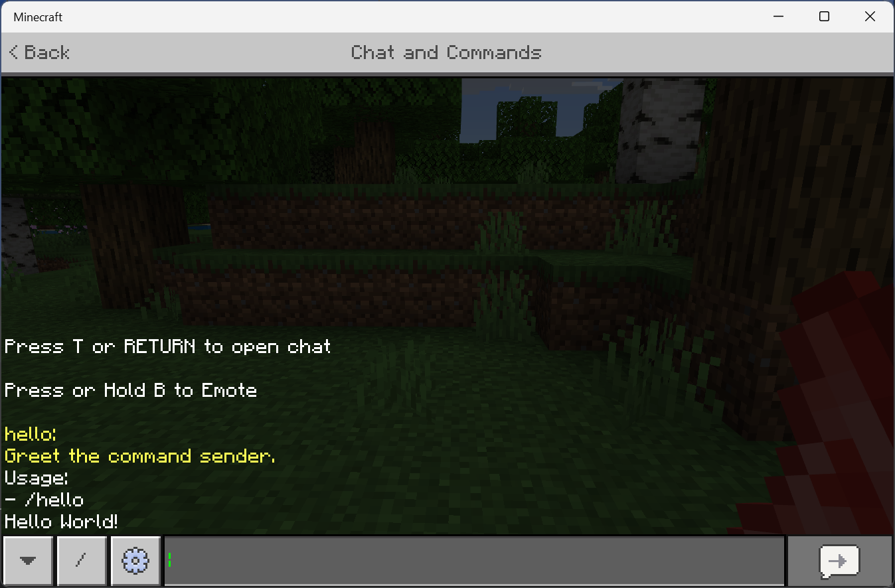

# Register commands

In this section, we'll walk you through creating a simple command. By the end of this section, you'll have
a basic understanding of how to define and register commands with Endstone.

## Create a command

Let's start with a simple command `/hello` that greets the command sender.

=== ":fontawesome-brands-python: Python"

    ``` python title="src/endstone_my_plugin/my_plugin.py" linenums="1" hl_lines="6-11"
    from endstone.plugin import Plugin

    class MyPlugin(Plugin):
        api_version = "{{ git.short_tag[1:].rsplit('.', 1)[0] }}"

        commands = {
            "hello": {
                "description": "Greet the command sender.",
                "usages": ["/hello"],
            }
        }

        # ...
    ```

=== ":simple-cplusplus: C++"

    ``` c++ title="src/my_plugin.cpp" linenums="1" hl_lines="7-9"
    #include "my_plugin.h"

    ENDSTONE_PLUGIN("my_plugin", "0.1.0", MyPlugin)
    {
        description = "My first C++ plugin for Endstone servers";

        command("hello")
            .description("Greet the command sender.")
            .usages("/hello");
    }
    ```

**And it's just as simple as that!** You've just created a new command with description and usages.

## Add permissions

By the default, all the commands in endstone requires the `operator` permission to execute for security reasons.
Since we are creating a simple command here, we might want to change its permission for everyone to use.

Let's make the following changes to our code.

=== ":fontawesome-brands-python: Python"

    ``` python title="src/endstone_my_plugin/my_plugin.py" linenums="1" hl_lines="11 15-20"
    from endstone.command import Command, CommandSender
    from endstone.plugin import Plugin

    class MyPlugin(Plugin):
        api_version = "{{ git.short_tag[1:].rsplit('.', 1)[0] }}"

        commands = {
            "hello": {
                "description": "Greet the command sender.",
                "usages": ["/hello"],
                "permissions": ["my_plugin.command.hello"],
            }
        }

        permissions = {
            "my_plugin.command.hello": {
                "description": "Allow users to use the /hello command.",
                "default": True, #(1)!
            }
        }

        # ...
    ```

    1.  :star: See tips

    !!! tip

        The `default` field sets the permission level required for executing the command. Possible values are:

        - `True` or `"true"`: everyone can execute this command
        - `False` or `"false"`: on one can execute this command, unless explicitly granted the permission.
        - `"op"`: only operators can execute this command
        - `"not_op"`: only non-operators can execute this command
        - `"console"`: only console can execute this command

=== ":simple-cplusplus: C++"

    ``` c++ title="src/my_plugin.cpp" linenums="1" hl_lines="10 12-14"
    #include "my_plugin.h"

    ENDSTONE_PLUGIN("my_plugin", "0.1.0", MyPlugin)
    {
        description = "My first C++ plugin for Endstone servers";

        command("hello")
            .description("Greet the command sender.")
            .usages("/hello")
            .permissions("my_plugin.command.hello");

        permission("my_plugin.command.hello")
            .description("Allow users to use the /hello command.")
            .default_(endstone::PermissionDefault::True); /*(1)!*/
    }
    ```

    1.  :star: See tips

    !!! tip

        The `default_` method sets the permission level required for executing the command. Possible values are:

        - `endstone::PermissionDefault::True`: everyone can execute this command
        - `endstone::PermissionDefault::False`: on one can execute this command, unless explicitly granted the permission.
        - `endstone::PermissionDefault::Operator`: only operators can execute this command
        - `endstone::PermissionDefault::NotOperator`: only non-operators can execute this command
        - `endstone::PermissionDefault::Console`: only console can execute this command

## Handle the commands

Now, the next step is to handle the commands we just created. Let's say we want to send a "Hello, World!" greeting
message to whoever execute this command. It's just a few more lines away from that.

=== ":fontawesome-brands-python: Python"

    ``` python title="src/endstone_my_plugin/my_plugin.py" linenums="1" hl_lines="1 22-26"
    from endstone.command import Command, CommandSender
    from endstone.plugin import Plugin

    class MyPlugin(Plugin):
        api_version = "{{ git.short_tag[1:].rsplit('.', 1)[0] }}"

        commands = {
            "hello": {
                "description": "Greet the command sender.",
                "usages": ["/hello"],
                "permissions": ["my_plugin.command.hello"],
            }
        }

        permissions = {
            "my_plugin.command.hello": {
                "description": "Allow users to use the /hello command.",
                "default": True,
            }
        }

        def on_command(self, sender: CommandSender, command: Command, args: list[str]) -> bool:
            if command.name == "hello":
                sender.send_message("Hello World!")

            return True

        # ...
    ```

=== ":simple-cplusplus: C++"

    ``` c++ title="include/my_plugin.h" linenums="1" hl_lines="5-12"
    #include <endstone/endstone.hpp>

    class MyPlugin : public endstone::Plugin {
    public:
        bool onCommand(endstone::CommandSender &sender, const endstone::Command &command, const std::vector<std::string> &args) override
        {
            if (command.getName() == "hello") 
            {
                sender.sendMessage("Hello World!");
            }
            return true;
        }

        // ...
    };
    ```

Now, [install] your plugin and restart your server. Join the game and type `/help hello`. You should see the usage
information, which indicates that our command has been successfully added to the game!

Now, type `/hello`, and you should receive the message "Hello World!".



[install]: install-your-plugin.md

## Add parameters to commands

Now, let's say we want to send a custom message to greet the sender instead of "Hello World!". We can add a parameter
to the command that accepts a message.

In Endstone, there are two basic kinds of parameters:

| Kind          | Description                                   | Syntax         |
|---------------|-----------------------------------------------|----------------|
| **Mandatory** | This parameter must be provided               | `<name: type>` |
| **Optional**  | This parameter is optional and can be omitted | `[name: type]` |

An optional parameter followed by a mandatory one registers both forms: `/home [list] <name: str>` accepts
`/home spawn` and `/home list spawn`. A usage can have at most 6 such optional parameters.

Let's change our code to add an **optional** parameter `msg` with `message` type. Based on the table above, the syntax
should be `[msg: message]`. Let's add it to our code.

=== ":fontawesome-brands-python: Python"

    ``` python title="src/endstone_my_plugin/my_plugin.py" linenums="1" hl_lines="10 24-27"
    from endstone.command import Command, CommandSender
    from endstone.plugin import Plugin

    class MyPlugin(Plugin):
        api_version = "{{ git.short_tag[1:].rsplit('.', 1)[0] }}"

        commands = {
            "hello": {
                "description": "Greet the command sender.",
                "usages": ["/hello [msg: message]"],
                "permissions": ["my_plugin.command.hello"],
            }
        }

        permissions = {
            "my_plugin.command.hello": {
                "description": "Allow users to use the /hello command.",
                "default": True,
            }
        }

        def on_command(self, sender: CommandSender, command: Command, args: list[str]) -> bool:
            if command.name == "hello":
                if len(args) == 0: #(1)!
                    sender.send_message("Hello World!")
                else:
                    sender.send_message(args[0])

            return True

        # ...
    ```

    1.  :white_check_mark: Here, we checked if the optional parameter is provided.

=== ":simple-cplusplus: C++"

    ``` c++ title="src/my_plugin.cpp" linenums="1" hl_lines="9"
    #include "my_plugin.h"

    ENDSTONE_PLUGIN("my_plugin", "0.1.0", MyPlugin)
    {
        description = "My first C++ plugin for Endstone servers";

        command("hello")
            .description("Greet the command sender.")
            .usages("/hello [msg: message]")
            .permissions("my_plugin.command.hello");

        permission("my_plugin.command.hello")
            .description("Allow users to use the /hello command.")
            .default_(endstone::PermissionDefault::True);
    }
    ```

    ``` c++ title="include/my_plugin.h" linenums="1" hl_lines="9-14"
    #include <endstone/endstone.hpp>

    class MyPlugin : public endstone::Plugin {
    public:
        bool onCommand(endstone::CommandSender &sender, const endstone::Command &command, const std::vector<std::string> &args) override
        {
            if (command.getName() == "hello") 
            {
                if (args.empty()) {
                    sender.sendMessage("Hello World!");
                }
                else {
                    sender.sendMessage(args[0]);
                }
            }
            return true;
        }

        // ...
    };
    ```

**:partying_face:  And it's done!** Now when the users use `/hello This is my message!`, "This is my message!" will
be shown to them instead of "Hello World!".

!!! tip

    To make the parameter mandatory, change the parameter from `[msg: message]` to `<msg: message>`

### Built-in types

In the section above, we added a parameter with type `message` which is a **built-in type** supported by Endstone.
Here is a full list of all built-in types currently supported.

| Type           | Alias                       | Description                                            | Possible Value                              |
|----------------|-----------------------------|--------------------------------------------------------|---------------------------------------------|
| `int`          |                             | Represents an integer                                  | `10`                                        |
| `float`        |                             | Represents a floating point number                     | `3.14`                                      |
| `bool`         |                             | Represents a boolean                                   | `true`                                      |
| `target`       | `actor`, `entity`, `player` | Represents a target selector                           | `@e`, `@r`, `PlayerName`                    |
| `str`          | `string`                    | Represents a string, terminated by space               | `Hello`                                     |
| `block_pos`    | `vec3i`                     | Represents a 3-Dimensionalinteger position             | `1 2 3`                                     |
| `pos`          | `vec3`, `vec3f`             | Represents a 3-Dimensional float position              | `1.0 2.0 3.0`                               |
| `message`      |                             | Represents a message with everything until end of line | `Hello World!`                              |
| `json`         |                             | Represents a JSON string                               | `{"key": "value"}`                          |
| `block`        |                             | Represents a block type                                | `wood`                                      |
| `block_states` |                             | Represents the block states                            | `["wood_type"="birch","stripped_bit"=true]` |
| `entity_type`  |                             | Represents a entity type                               | `minecraft:creeper`                         |

### User-defined enum types

Enum Types can be used to represent a set of predefined string constants. This behavior is similar to how literal types
function in modern programming languages such as Node.js and Python. Enum types provide a way to define a "type"
comprised of a set of named constants, referred to as the enumeration, or in short, "enum".

Endstone allows developer to add their own enums. The basic syntax follows the pattern:

- Mandatory: `(value1|value2|value3)<name: EnumType>`
- Optional: `(value1|value2|value3)[name: EnumType]`

Here, all possible values, separated by the pipeline operator `|`, are scoped inside the parentheses `()`,
followed by the parameter kind, name and type.

!!! example

    An example of using enum types in command usages is: `/home (add|list|del)<action: HomeAction>`
    
    In this example, the parameter is named `action` and has a **user-defined enum** type `HomeAction`. 
    When using the command, the user must select one of the specified action from the set: `add`, `list`, or `del`.


The type of a parameter can also be the name of a [soft enum](#soft-enums), as in `<warp: WarpNames>`.

## Register a command tree

Usage strings describe a command as text. To describe it as a tree of literals and arguments, as Paper's Brigadier
command API does, register it through `Commands`, the registrar every plugin owns. The usage-string commands above
keep working, and nothing here replaces them.

The registrar is `getCommands()` in C++. In Python its methods are on the plugin itself, as `register_command` and
`register_soft_enum`. Register in `onEnable`, so that `/reload` registers again.

Let's build `/greet`, which has a subcommand `/greet to <player>` and a free-form `/greet say <text>`.

=== ":fontawesome-brands-python: Python"

    ``` python title="src/endstone_my_plugin/my_plugin.py" linenums="1"
    from endstone.brigadier import CommandContext, StringArgumentType
    from endstone.command import Commands
    from endstone.plugin import Plugin

    class MyPlugin(Plugin):
        api_version = "{{ git.short_tag[1:].rsplit('.', 1)[0] }}"

        def on_enable(self) -> None:
            node = (
                Commands.literal("greet")
                .then(
                    Commands.literal("to").then(
                        Commands.argument("name", StringArgumentType.word()).executes(self.greet_to)
                    )
                )
                .then(
                    Commands.literal("say")
                    .requires(lambda source: source.sender.has_permission("my_plugin.command.greet.say"))
                    .then(Commands.argument("text", StringArgumentType.greedy_string()).executes(self.greet_say))
                )
                .build()
            )
            self.register_command(node, "Greet someone.", ["hi"])

        def greet_to(self, context: CommandContext) -> int:
            name = context.get_argument("name")
            context.source.sender.send_message(f"Hello, {name}!")
            return 1

        def greet_say(self, context: CommandContext) -> int:
            context.source.sender.send_message(context.get_argument("text"))
            return 1
    ```

=== ":simple-cplusplus: C++"

    ``` c++ title="include/my_plugin.h" linenums="1"
    #include <endstone/endstone.hpp>

    class MyPlugin : public endstone::Plugin {
    public:
        void onEnable() override
        {
            using endstone::Commands;
            using endstone::brigadier::StringArgumentType;

            auto node =
                Commands::literal("greet")
                    .then(Commands::literal("to").then(
                        Commands::argument("name", StringArgumentType::word())
                            .executes([](const auto &context) {
                                const auto &name = context.template getArgument<std::string>("name");
                                context.getSource()->getSender()->sendMessage("Hello, " + name + "!");
                                return 1;
                            })))
                    .then(Commands::literal("say")
                              .requires_([](const endstone::CommandSource &source) {
                                  return source->getSender()->hasPermission("my_plugin.command.greet.say");
                              })
                              .then(Commands::argument("text", StringArgumentType::greedyString())
                                        .executes([](const auto &context) {
                                            context.getSource()->getSender()->sendMessage(
                                                context.template getArgument<std::string>("text"));
                                            return 1;
                                        })))
                    .build();
            getCommands()->registerCommand(node, "Greet someone.", {"hi"});
        }

        // ...
    };
    ```

The pieces are:

- `Commands.literal` starts a keyword and `Commands.argument` adds a named, typed argument.
- `StringArgumentType` has three forms: `word` reads one word, `string` reads a word or a `"quoted phrase"`, and
  `greedy_string` (`greedyString` in C++) reads everything to the end of the line.
- `executes` runs a handler on the node, and a result above `0` counts as success. A node without a handler is only a
  step towards one.
- `requires` (`requires_` in C++, as `requires` is a C++ keyword) hides the node from players who fail it, and the
  server checks it again when the command runs. The handler reads the sender through `source.sender`.
- `register_command` returns the labels that registered, including the aliases and `plugin:label` forms. A label that
  another command holds is skipped, and the command stays reachable as `plugin:label`.

A keyword can sit beside an argument at the same position, as in Brigadier: `/warp list` runs the `list` keyword and
`/warp spawn` runs `<name>`. A tree that Bedrock cannot express is refused when you register it, with
`std::invalid_argument` in C++ and `ValueError` in Python, and the message names the clash, such as a string argument
beside a player argument at the same position, or a keyword followed by more arguments beside a greedy string.

## Soft enums

A soft enum is a list of completions that the client suggests while a player types, and that you can change while the
server runs. Create one through the registrar, and use it as an argument type.

=== ":fontawesome-brands-python: Python"

    ``` python title="src/endstone_my_plugin/my_plugin.py" linenums="1"
    from endstone.brigadier import CommandContext
    from endstone.command import ArgumentTypes, Commands
    from endstone.plugin import Plugin

    class MyPlugin(Plugin):
        api_version = "{{ git.short_tag[1:].rsplit('.', 1)[0] }}"

        def on_enable(self) -> None:
            self.warps = self.register_soft_enum("WarpNames", ["spawn", "market"])
            node = (
                Commands.literal("warp")
                .then(Commands.argument("name", ArgumentTypes.soft_enum("WarpNames")).executes(self.warp))
                .build()
            )
            self.register_command(node, "Teleport to a warp.", ["w"])

        def warp(self, context: CommandContext) -> int:
            name = context.get_argument("name")
            if name not in self.warps.values:
                context.source.sender.send_error_message(f"Unknown warp: {name}")
                return 0

            # ...
            return 1

        def add_warp(self, name: str) -> None:
            self.warps.add_values([name])
    ```

=== ":simple-cplusplus: C++"

    ``` c++ title="include/my_plugin.h" linenums="1"
    #include <endstone/endstone.hpp>

    class MyPlugin : public endstone::Plugin {
    public:
        void onEnable() override
        {
            using endstone::ArgumentTypes;
            using endstone::Commands;

            warps_ = getCommands()->registerSoftEnum("WarpNames", {"spawn", "market"}).get();
            auto node = Commands::literal("warp")
                            .then(Commands::argument("name", ArgumentTypes::softEnum("WarpNames"))
                                      .executes([this](const auto &context) {
                                          const auto &name = context.template getArgument<std::string>("name");
                                          const auto values = warps_->getValues();
                                          if (std::find(values.begin(), values.end(), name) == values.end()) {
                                              context.getSource()->getSender()->sendErrorMessage("Unknown warp: " + name);
                                              return 0;
                                          }

                                          // ...
                                          return 1;
                                      }))
                            .build();
            getCommands()->registerCommand(node, "Teleport to a warp.", {"w"});
        }

        void addWarp(const std::string &name) { warps_->addValues({name}); }

        // ...

    private:
        std::shared_ptr<endstone::SoftEnum> warps_;
    };
    ```

- `setValues`, `addValues` and `removeValues` (`set_values`, `add_values`, `remove_values` in Python) update the
  completions of every player at once, without resending the command list. They can be called from any thread.
- A soft enum only completes. The server accepts any word a player types, so the handler has to validate it, as
  `warp` does above.
- The name is unique across the server and shows up in the client, so name it for its content in CamelCase, such as
  `WarpNames`. A soft enum stays registered while its plugin is disabled and is removed on `/reload`.
- Soft enums the server owns, such as `ScoreboardObjectives`, can be used as an argument type but cannot be changed.

## Take arguments as words with BasicCommand

If you only want the words the player typed, as `args` in `onCommand`, subclass `BasicCommand` and register it with a
label. The client shows it as `/label <args: message>`.

=== ":fontawesome-brands-python: Python"

    ``` python title="src/endstone_my_plugin/my_plugin.py" linenums="1"
    from endstone.command import BasicCommand, CommandSourceStack
    from endstone.plugin import Plugin

    class EchoCommand(BasicCommand):
        def execute(self, source: CommandSourceStack, args: list[str]) -> None:
            source.sender.send_message(" ".join(args))

        def permission(self) -> str | None:
            return "my_plugin.command.echo"

    class MyPlugin(Plugin):
        api_version = "{{ git.short_tag[1:].rsplit('.', 1)[0] }}"

        def on_enable(self) -> None:
            self.register_command("echo", "Repeat a message.", [], EchoCommand())
    ```

=== ":simple-cplusplus: C++"

    ``` c++ title="include/my_plugin.h" linenums="1"
    #include <endstone/endstone.hpp>

    class EchoCommand : public endstone::BasicCommand {
    public:
        void execute(const endstone::CommandSource &source, const std::vector<std::string> &args) override
        {
            std::string message;
            for (const auto &arg : args) {
                message += arg + " ";
            }
            source->getSender()->sendMessage(message);
        }

        [[nodiscard]] std::optional<std::string> permission() const override { return "my_plugin.command.echo"; }
    };

    class MyPlugin : public endstone::Plugin {
    public:
        void onEnable() override
        {
            getCommands()->registerCommand("echo", "Repeat a message.", {}, std::make_shared<EchoCommand>());
        }

        // ...
    };
    ```

`permission` is optional. A sender without it does not see the command and cannot run it. Throwing a
`brigadier::CommandSyntaxException` from `execute` sends its message to the sender as an error.

## Migrate usage strings to a tree

| Usage            | Tree                                                      |
|------------------|-----------------------------------------------------------|
| `(a\|b)`         | two literals, `Commands.literal("a")` and `Commands.literal("b")` |
| `[x: T]`         | an argument under a node that also `executes`             |
| `<m: message>`   | `StringArgumentType.greedy_string()`                      |
| `<w: str>`       | `StringArgumentType.word()`, or `string()` to allow quotes |
| `<w: WarpNames>` | `ArgumentTypes.soft_enum("WarpNames")`                    |
| `<n: int>`       | `IntegerArgumentType.integer()`, or `integer(1, 64)` to bound it |
| `<x: float>`     | `DoubleArgumentType.double_arg()`, or `FloatArgumentType.float_arg()` |
| `<b: bool>`      | `BoolArgumentType.bool()`                                 |
| `<t: target>`    | `ArgumentTypes.actors()`, or `actor()` for exactly one    |
| `<p: player>`    | `ArgumentTypes.players()`, or `player()` for exactly one  |
| `<p: block_pos>` | `ArgumentTypes.block_position()`                          |
| `<p: pos>`       | `ArgumentTypes.fine_position()`                           |

A bounded number refuses a value outside its range with Brigadier's message, such as
`Integer must not be more than 64, found 65`, before the command runs. In C++ the names are
`IntegerArgumentType::integer`, `FloatArgumentType::floatArg`, `DoubleArgumentType::doubleArg` and
`BoolArgumentType::bool_`, in `endstone::brigadier`.

The `json` and `block_states` types have no tree argument yet. Until then, keep those in a usage string.
